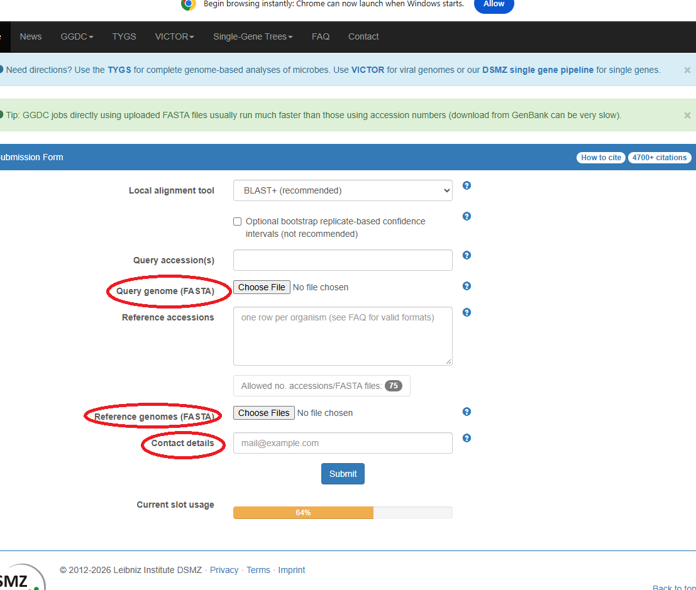
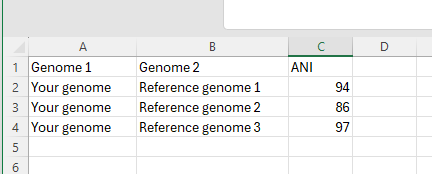

# Day 6: Comparative genomics
To determine the taxonomic position of the genome. We will compare it with reference genomes of type strains by calculating digital DNA–DNA hybridization (dDDH) and average nucleotide identity (ANI) values.

## Calculate DNA–DNA hybridization (dDDH)

* Submit your genomes in https://ggdc.dsmz.de/ggdc.php
* Please remember to include your email address in the contact details. You will receive the results by email.
.

## Calculate average nucleotide identity (ANI)

* Go to https://www.ezbiocloud.net/tools/ani 
* Upload your genome under “1. Genome sequence A” by clicking “Upload FASTA.”
* Upload the reference genome under “2. Genome sequence B” by clicking “Upload FASTA.”
* Click “Calculate.”
* Copy the ANI value and paste it into an Excel file.
* Repeat the same process with the other reference genomes.



### Alternative ANI command-line version
```bash
java -jar /projappl/$PROJECT/OAU.jar -u /projappl/$PROJECT/usearch11 -fd path/to/genomes/ -n 8 -fmt matrix -o ani_matrix.txt
```
## Average amino acid identity
We are going to call the program first

```bash
export PATH="/projappl/$PROJECT/ezaai_tykky/bin:$PATH"
```
Secondly, we create databases for each protein annotation
```bash
ezaai convert -i proteins_1.faa -s prot -o db/proteins_1.db
ezaai convert -i proteins_2.faa -s prot -o db/proteins_2.db
ezaai convert -i proteins_3.faa -s prot -o db/proteins_3.db
```
Finally, we run ezaai
```bash
ezaai calculate -i db/ -j db/ -o aai_results.tsv -t 8
```

Based on the ANI and dDDH values, does the genome represent a previously described species or a potentially novel species?
Does the genome represent a new strain?
