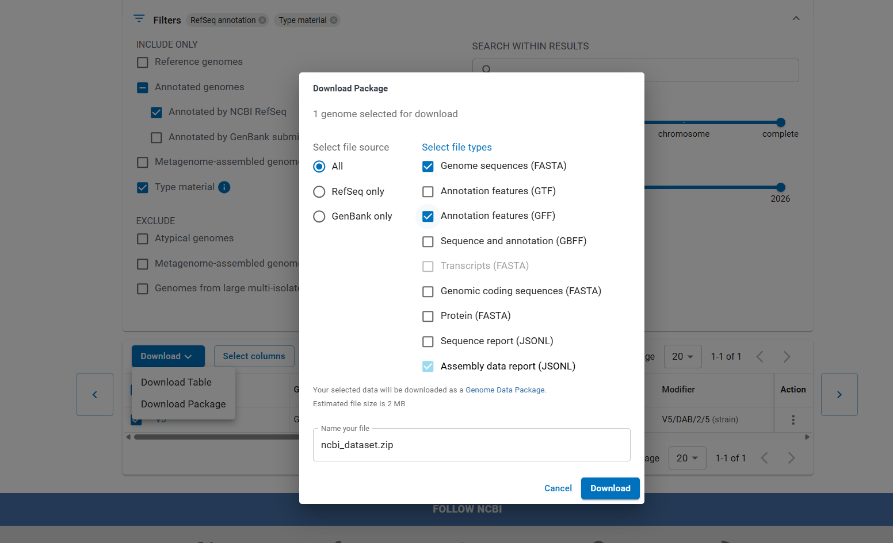
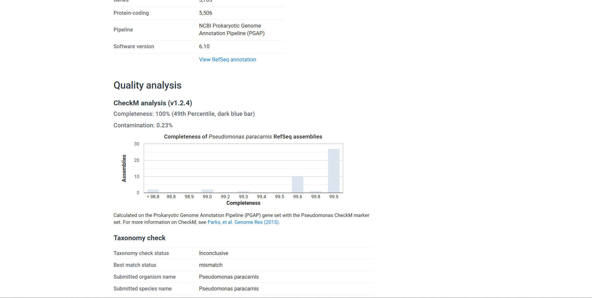
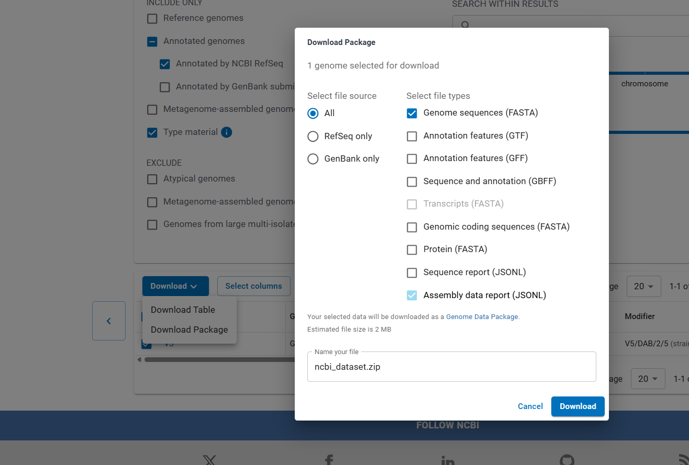
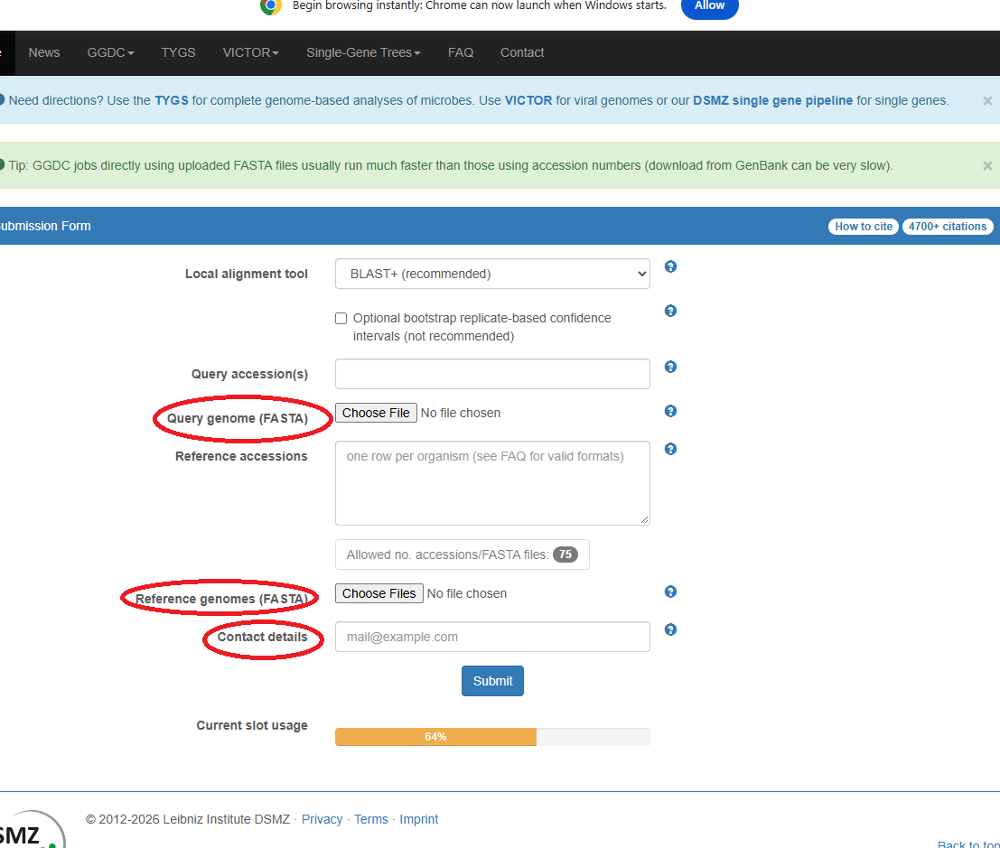
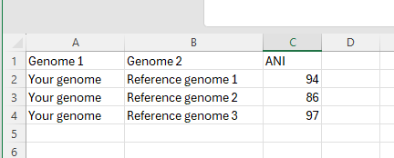

# Day 6: Comparative genomics

To determine the taxonomic position of the genome. We will compare it with reference genomes of type strains by calculating digital DNA–DNA hybridization (dDDH) and average nucleotide identity (ANI) values.


# Downloading reference genomes from NCBI Datasets (https://www.ncbi.nlm.nih.gov/datasets/)
Go to NCBI Datasets and download the closest genome reference identified in the GTDB-Tk results file:`gtdbtk.bac120.summary.tsv`.

1. In the same file, check the `closest_genome_reference` column and download fewer than 10 genomes belonging to the same species. 
   * Select genomes annotated by NCBI RefSeq
   * Download both the genome sequences (FASTA) and the annotation features (GFF).

   * :warning: **NOTE: Make sure that all genomes downloaded from NCBI are of good quality. Check their assembly quality, completeness, and contamination levels before downloading them.**

2. In the same file, check the `other_related_references` column and select additional genomes with the highest ANI values, ensuring that they represent different species and different genera listed in this column.
   If no different genera are represented in the `other_related_references column`, search NCBI Datasets and select one or two additional genomes representing different genera.
   To download the genomes in `NCBI datasets`, 
   * Select genomes annotated by NCBI RefSeq
   * Select genomes identified as type material (if possible)
   * Under Download packages, select Genome sequences (FASTA) only.
   * :warning: **NOTE: Make sure that all genomes downloaded from NCBI are of good quality. Check their assembly quality, completeness, and contamination levels before downloading them.**

3. Organize all downloaded files into two separate folders:
   * One folder containing all genome sequences in FASTA format.
   * Another folder containing all GFF3 annotation files.
4. Today, we will use the fasta format files to calculate genome related indices.

## Calculate DNA–DNA hybridization (dDDH)

* Submit your genomes (fasta format) in https://ggdc.dsmz.de/ggdc.php
* Please remember to include your email address in the contact details. You will receive the results by email.


## Calculate average nucleotide identity (ANI)

* Go to https://www.ezbiocloud.net/tools/ani 
* Upload your genome under “1. Genome sequence A” by clicking “Upload FASTA.”
* Upload the reference genome under “2. Genome sequence B” by clicking “Upload FASTA.”
* Click “Calculate.”
* Copy the ANI value and paste it into an Excel file.
* Repeat the same process with the other reference genomes.



### Alternative ANI command-line version

```bash
java -jar /projappl/$PROJECT/OAU.jar -u /projappl/$PROJECT/usearch11 -fd path/to/genomes/ -n 8 -fmt matrix -o ani_matrix.txt
```

## Average amino acid identity (https://endixk.github.io/ezaai/)

We are going to call the program first

```bash
export PATH="/projappl/$PROJECT/ezaai_tykky/bin:$PATH"
```

Secondly, we extract profiles DB from genomes using prodigal
Here’s what extract does:
    1. It takes your genome sequences (FASTA files of assembled genomes) as input.
    2. It runs Prodigal, a gene-finding program, to locate the protein-coding genes in each genome and translate them into protein sequences.
    3. It saves those proteins as a profile DB, a ready-made database file for each genome that the next step can compare quickly.
```bash
ezaai extract -i genome_1.fasta -o db/genome_1.db
ezaai extract -i genome_2.fasta -o db/genome_2.db
ezaai extract -i genome_3.fasta -o db/genome_3.db
```
Finally, we run ezaai

```bash
ezaai calculate -i db/ -j db/ -o aai_results.tsv -t 8
```
Based on the ANI and dDDH values, does the genome represent a previously described species or a potentially novel species?
Does the genome represent a new strain?
