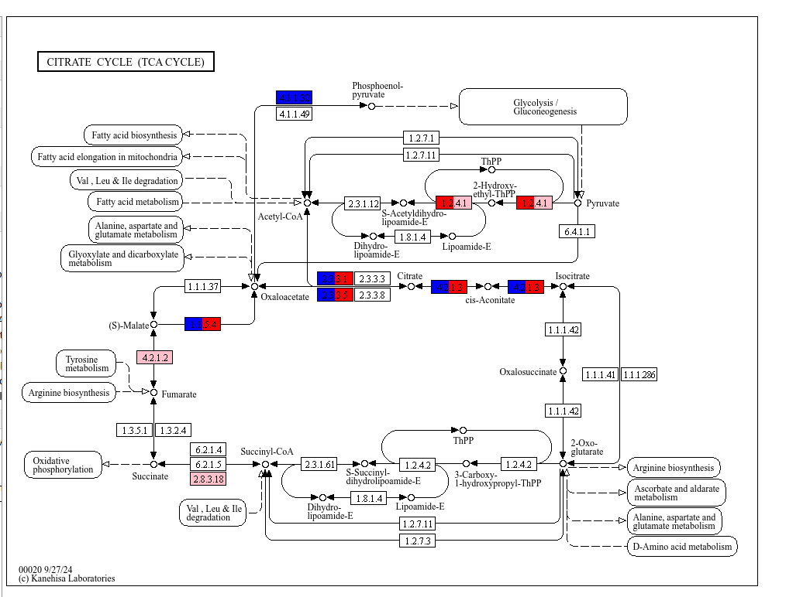
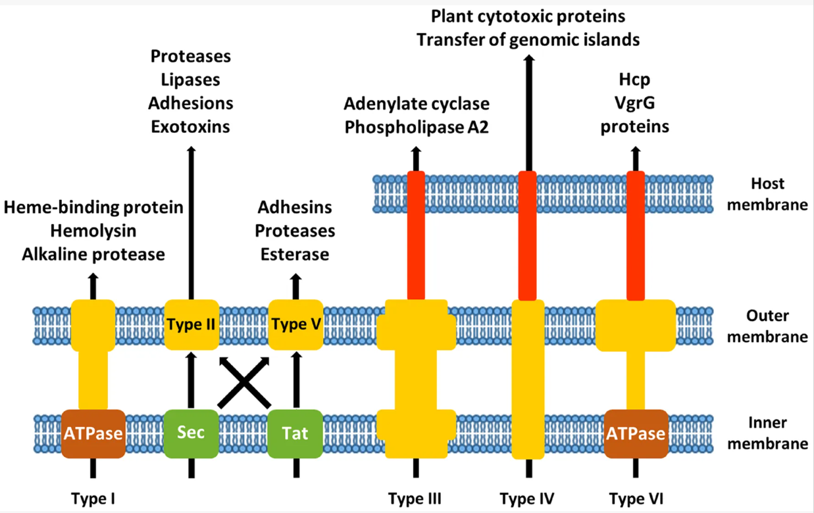

# Day 7: Genome annotation

We will compare the functional annotations of multiple genomes to identify differences in their functional profiles.
For this, we will run Bakta on all the genomes downloaded from NCBI.

## Run bakta in all genomes

1. Step 1: make the list of genomes
```bash
ls genomes/*.fna > namelist
```
2. save this as bakta.sh

```bash
#!/bin/bash -l
#SBATCH --job-name=bakta
#SBATCH --output=bakta_%A_%a.out
#SBATCH --error=bakta_%A_%a.err
#SBATCH --account=<project>
#SBATCH --partition=small
#SBATCH --time=02:00:00
#SBATCH --ntasks=1
#SBATCH --cpus-per-task=8
#SBATCH --mem=16G
#SBATCH --array=1-10

module load bio-apps
module load py-bakta

name=$(sed -n "$SLURM_ARRAY_TASK_ID"p namelist)

bakta --output $name.bakta --threads 8 $name
```
3. submit it

```bash
sbatch bakta.sh
```


## KEGG-based functional analysis of multiple genomes

```bash
mkdir -p kegg_ids
grep -o "KEGG:K....." genome_1.gff3 | tr ":" "\t" > kegg_ids/genome_1_kegg_ids.txt 
grep -o "KEGG:K....." genome_2.gff3 | tr ":" "\t" > kegg_ids/genome_2_kegg_ids.txt
grep -o "KEGG:K....." genome_3.gff3 | tr ":" "\t" > kegg_ids/genome_3_kegg_ids.txt
```

Select column 1 with kegg id and add column 2 with colors

```bash
awk '{print $2 "\tblue"}' genome_1.gff3_kegg_ids.txt> kegg_ids/genome_1.gff3_kegg_ids_color.txt
awk '{print $2 "\tred"}' genome_2.gff3_kegg_ids.txt> kegg_ids/genome_2.gff3_kegg_ids_color.txt
awk '{print $2 "\tpink"}' genome_2.gff3_kegg_ids.txt> kegg_ids/genome_3.gff3_kegg_ids_color.txt
cat kegg_ids/genome_1.gff3_kegg_ids_color.txt kegg_ids/genome_2.gff3_kegg_ids_color.txt kegg_ids/genome_3.gff3_kegg_ids_color.txt > kegg_mapper_color.txt
```

submit file  `kegg_mapper_color.txt` to (https://www.genome.jp/kegg/mapper/color.html)


What are the main difference between your genome and the public genomes?  
Do they differ in main metabolism and secondary metabolism?

## MacSynfinder

Determine Bacterial scretion systems in your bacteria (https://github.com/gem-pasteur/macsyfinder)


```bash
export PATH="/projappl/$PROJECT/macsyfinder/bin:$PATH"
```
:warning: NOTE: Do not work with hypotheticals.faa	

```bash
macsyfinder --db-type ordered_replicon \
  --sequence-db bakta_proteins.faa \
  --models-dir /scratch/$PROJECT/DATABASES/macsyfinder_models \
  --models TXSScan all \
  -o macsyfinder_out
```

For multiple genomes

```bash
mkdir -p macsyfinder
ls proteins_fasta/*.faa > files_list.txt
while IFS= read -r fasta; do
    sample=$(basename "$fasta" .faa)
    macsyfinder --db-type ordered_replicon \
  --sequence-db "$fasta" \
  --models-dir /scratch/$PROJECT/DATABASES/macsyfinder_models \
  --models TXSScan all \
  -o macsyfinder/"$sample"
done < files_list.txt
```

check file `macsyfinder/genome_1/best_solution_summary.tsv`

If you want, you can combine all the results into a single file.
```bash
 grep -hv '^#' macsyfinder/*/best_solution_summary.tsv | grep -v '^$' | sed '1!{/^replicon/d}' >summary_all.tsv
```

## Antismash (Secondary metabolites)

If you're interested on the secondary metabolites your strain produces (such as antibiotics or other bioactive molecules)

* Go to https://antismash.secondarymetabolites.org/#!/start
* Upload bakta.gbff one at a time

## Alternative: antiSMASH command-line version :muscle:

```bash
module load bio-apps/v202603
module load antismash/8.0.4
```

```bash
antismash bakta.gbff \
  --taxon bacteria \
  --databases /scratch/$PROJECT//DATABASES/antismash_db
  --output-dir antismash_out/genome \
  --cpus 8
  --no-zip-output --cb-knownclusters --cb-subclusters --cc-mibig
```

Running antiSMASH on multiple genomes

```bash
for bakta_gbff in *.gbff; do antismash "$bakta_gbff" --taxon bacteria --output-dir antismash_out/"${bakta_gbff%.gbff}" --cpus 8 --databases /scratch/$PROJECT//DATABASES/antismash_db --no-zip-output --cb-knownclusters --cb-subclusters --cc-mibig; done
```

or

```bash
 mkdir -p antismash_out
for bakta_gbff in gbff/*.gbff; do 
name=$(basename "$bakta_gbff" .gbff)
mkdir -p antismash_out/$bakta_gbff
antismash "$bakta_gbff" --taxon bacteria --output-dir antismash_out/"$bakta_gbff" --cpus 8 \
--databases /scratch/project_2020859/DATABASES/antismash_db --no-zip-output --cb-knownclusters --cb-subclusters --cc-mibig \
--genefinding-tool prodigal
done


```

summarise all antismash results
```bash
python /projappl/project_2020859/summarize_antismash.py antismash_out/ pseudomonas_antimash_output
```

## Ecological inference

Can your isolate be found in other environments? Which environments? (https://branchwater.sourmash.bio/)
