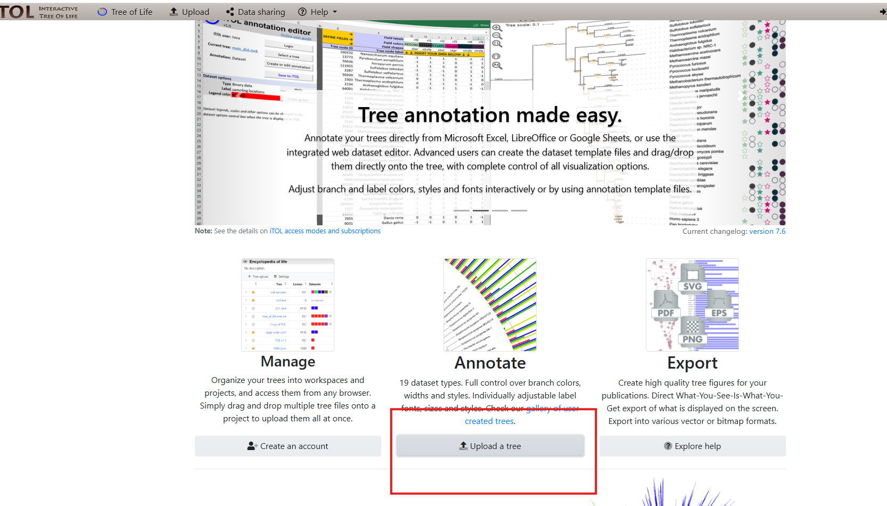
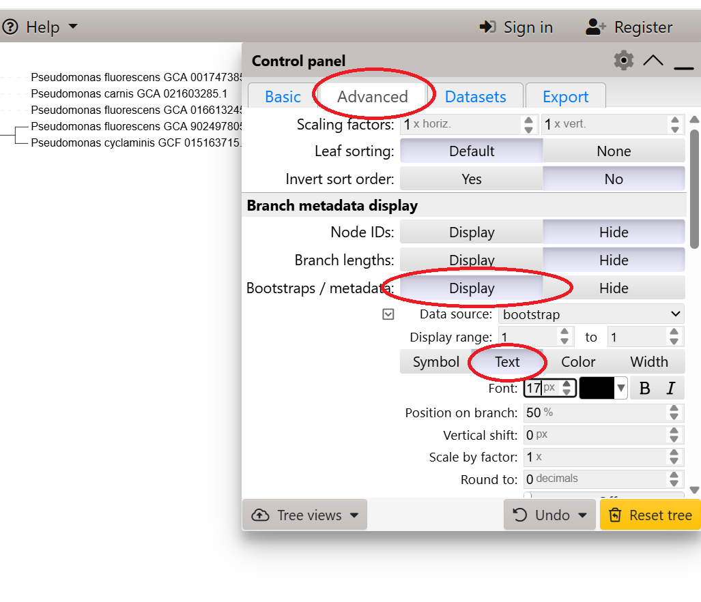
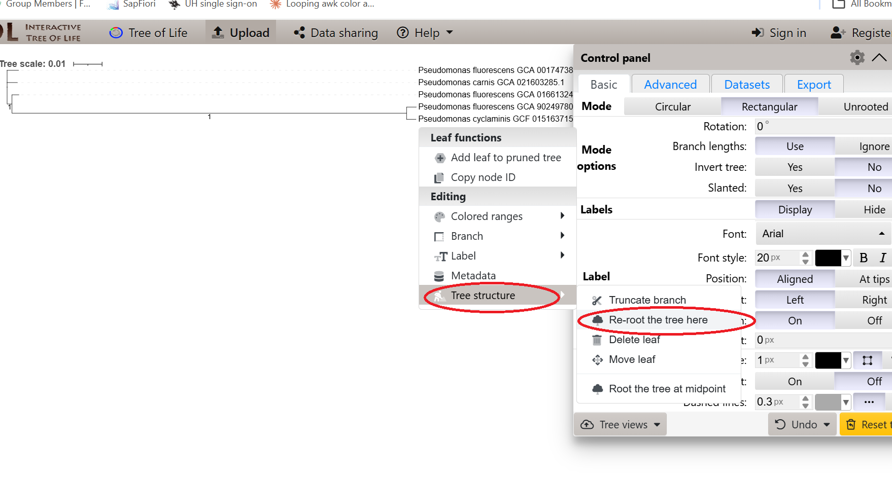

# Day 8: Pangenomics

A bacterial pangenome is the complete set of genes found across all strains of a bacterial species. Therefore, we will compare all genomes belonging to the same species to identify the core genome, consisting of genes present in all or nearly all strains, and the accessory genome, consisting of genes present in only some strains. We will use Roary to perform the pangenome analysis and identify the core and accessory genomes.
Finally, we will construct a maximum-likelihood phylogenetic tree using the core-gene alignment generated by Roary. For each species, we will include all available genomes from that species, together with one or two genomes from closely related species as outgroups.

## Roary (https://sanger-pathogens.github.io/Roary/)

Combine all the GFF3 files generated by Bakta into a single folder.
 * :warning: Don't forget to include an outgroup genome. It can belong to a different genus or a distantly related species. We need an outgroup to properly root the phylogenetic tree.
```bash
mkdir gff3
cp *bakta/*gff3 gff3/.
```

```bash
sinteractive --account $PROJECT --cores 16 --mem 16000 --time 04:00:00
module load bio-apps/v202603
module load roary/3.13.0
```

```bash
roary -p 16 -f roary_output -e -n gff3/*.gff3
```

## Optional: Use Panaroo as an alternative to Roary if Roary takes too long to run. (https://gthlab.au/panaroo/#/)
```bash
module purge
export PATH="/projappl/project_2020859/panaroo_tykky/bin:$PATH"
panaroo -i gff3/*.gff3 -o panaroo_roarylike -t 16 --clean-mode sensitive --refind-mode off -c 0.95 -f 0.95 \
        --core_threshold 0.99 -a core --aligner mafft

```


## Build a phylogenetic tree

### Using FastTree (https://morgannprice.github.io/fasttree/)

FastTree is a fast and computationally efficient tool for inferring phylogenetic trees. It uses a distance-based approach, similar to neighbor-joining (NJ), to generate an initial tree, which is then refined using an approximate maximum-likelihood method through a limited number of optimization rounds.

```bash
export PATH="/projappl/project_2020859/pangenome_tykky/bin:$PATH"
FastTree -nt -gtr roary_output or panaroo/core_gene_alignment.aln > roary_output/my_tree.newick
```


### Using IQ-TREE (https://iqtree.github.io/)

IQ-TREE is a tool that infers phylogenetic trees by maximum likelihood, with automatic model selection and fast bootstrap support.

```bash
module load bio-apps/v202603
module load iqtree3/3.1.4
iqtree3 -s roary_output/core_gene_alignment.aln -m MFP -B 1000 -T AUTO --prefix core_tree
```

## Upload your phylogenetic tree

We are going to use ITOL (https://itol.embl.de/) to visualize and upload our phylogenetic trees



* Click on __Upload a tree__

* Add the bootstrap values or local support values to the phylogenetic tree.

* Root the tree using either midpoint rooting or an outgroup.



# Visualize the pangenome results
## Using roary
```bash
module load bio-apps/v202603
module load roary/3.13.0
python /projappl/project_2020859/roary_plots.py roary_output/my_tree.newick roary_output/gene_presence_absence.csv
```
check `pangenome_frequency.png` `pangenome_matrix.png` `pangenome_pie.png`

## Using Panaroo
```bash
cd results_panaroo
module load bio-apps/v202603
module load roary/3.13.0
python /projappl/project_2020859/roary_plots.py core_tree.newick gene_presence_absence_roary.csv
```
check `pangenome_frequency.png` `pangenome_matrix.png` `pangenome_pie.png`
